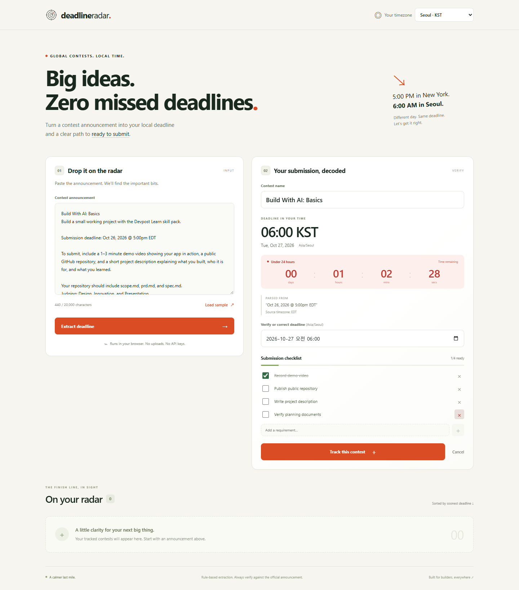

# Deadline Radar

**Global contests. Local time. A clearer path to submitting.**

Deadline Radar helps students who enter worldwide hackathons turn pasted contest announcements into a local deadline, a live countdown, and an editable submission checklist. It was built as a new project for Devpost **Build With AI: Basics**.

An announcement saying **Oct 26, 2026 at 5:00 PM EDT** actually closes at **Oct 27, 2026 at 06:00 KST**. That calendar-day change is easy to miss. Deadline Radar puts it next to the source text so you can check it before tracking the contest.



## Run locally

Use Node.js 24 and npm. No account, API key, environment file, or backend is needed.

```sh
npm install
npm run dev
```

Open the localhost URL Vite prints (usually `http://localhost:5173`). Press **Load sample**, then **Extract deadline**. Select **Seoul · KST** if your computer uses another timezone. Verify the conversion, edit the checklist, and press **Track this contest**. Refresh to see the saved entry.

```sh
npm test          # run the parser/time regression tests once
npm run build    # type-check and build the static app into dist/
npm run preview  # optionally inspect the production build
```

An additional browser smoke check is included:

```sh
# If Chrome/Edge is not installed, install Playwright's Chromium first:
npx playwright install chromium
npm run test:smoke
```

The smoke script starts a temporary preview server on port 4179, checks the real browser flow, writes ignored screenshots under `test-results/`, and closes its browser and server. Stop your manually started dev/preview server with Ctrl+C when finished.

## What it does

- Parses named-month dates, day-month dates and ISO calendar dates with 12-hour or 24-hour times.
- Converts the deadline into the selected local timezone; changing the display zone preserves the deadline instant.
- Displays a live countdown: green at 72+ hours, amber at 24–72 hours, red below 24 hours, and Closed after expiry.
- Extracts video, repository/GitHub, description, slides and PDF requirements; supports adding, renaming, removing and checking tasks.
- Keeps the parsed source phrase visible and allows manual deadline correction.
- Saves tracked contests and timezone preference in localStorage, with soonest deadlines first.
- Works without runtime network requests, uploads or model calls. Layout adapts to phones and desktops.

## Parsing boundaries

This is a transparent rule-based helper, not a universal natural-language parser. Always compare the result and checklist with the official rules. Keyword detection can include optional or negated requirements; remove or edit them as needed.

| Notation                                   | Interpretation                                                                      |
| ------------------------------------------ | ----------------------------------------------------------------------------------- |
| ET / PT / CT / MT                          | New York / Los Angeles / Chicago / Denver, using daylight saving for the given date |
| EDT / EST, PDT / PST, CDT / CST, MDT / MST | Explicit fixed daylight/standard offsets                                            |
| UTC / GMT                                  | UTC+00:00                                                                           |
| KST / JST                                  | UTC+09:00                                                                           |
| CET / CEST                                 | UTC+01:00 / UTC+02:00                                                               |
| BST                                        | British Summer Time, UTC+01:00                                                      |
| IST                                        | India Standard Time, UTC+05:30                                                      |

Missing year uses the current year with a visible warning. Missing timezone uses the display timezone with a warning. **A time alone, such as “11:59 PM PT,” requires manual date correction**; the app never guesses the calendar date. Unsupported zones and numeric offsets require manual correction. Impossible dates/times are rejected. A repeated clock-change hour can be ambiguous, so confirm it with the organizer. Saved source notes remain available after a manual correction.

Storage belongs to this browser and origin. Changing browsers or dev-server ports gives a separate list. Disabled/full/corrupt storage produces a visible warning instead of silently promising persistence. There is no cloud backup or notification service.

## How I built it with the Learn skill pack

Installed the official pack in the new, empty project folder:

```sh
npx skills add challengepost/learn-ai-basics --all -y
```

The installed instructions are retained under [`.agents/skills/`](.agents/skills/), with `skills-lock.json` recording the source. Followed the six stages in order:

1. **1-start:** checked the fresh workspace and captured the supplied brief in an ignored learner profile.
2. **2-scope:** defined the conversion-plus-checklist kernel and a firm local-only boundary in [devpost/scope.md](devpost/scope.md).
3. **3-prd:** specified the visible journey, correction behavior and failure states in [devpost/prd.md](devpost/prd.md).
4. **4-spec:** mapped that journey to React, pure parser/time utilities and localStorage in [devpost/spec.md](devpost/spec.md).
5. **5-build:** implemented and verified the integrated app; tracked the work in [devpost/checklist.md](devpost/checklist.md).
6. **6-ship:** prepared this README, the [submission description and recording script](SUBMISSION.md), and an [offline app map](devpost/app-map.html). Public publishing and recording remain manual steps.

The user supplied the interview answers and explicitly requested autonomous decisions with no questions. This adapted the pack's normal interview, approval and hands-on checkpoints; the checklist distinguishes agent verification from human review. Submission copy is a draft to review, not a claim that the entry has been submitted.

## What I learned

The concrete engineering lessons from this build:

- A real acceptance example is more useful than “handle timezones”: the EDT → next-day KST case became a regression test.
- A local clock time and an absolute instant are different data. Save the instant; apply the display timezone only when reading or editing it.
- ET and EST are different promises. Date-aware zones and fixed offsets need separate handling.
- An inspectable parser can be useful without an LLM if uncertainty stays visible and users can correct the result.
- Keeping the core loop small left room to verify saved tasks, awkward inputs and mobile layout.

## Source guide

`src/App.tsx` owns the user journey. `src/lib/parser.ts` extracts deadlines and requirements. `src/lib/time.ts` converts and formats time. `src/lib/storage.ts` validates browser data. `src/components/` contains the checklist and countdown. `src/styles.css` defines the responsive design.

Verification details are recorded in [devpost/verification.md](devpost/verification.md). No remote was created and no code was pushed by the build agent.
